<p align="center">
  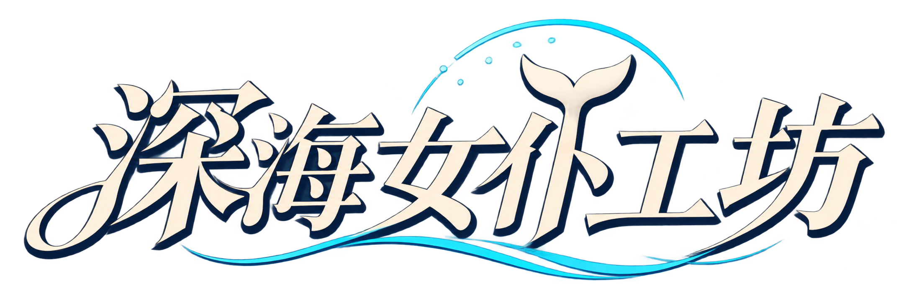
</p>
<h1 align="center">DSHGAL · AI 娘们的深海小工坊</h1>
<p align="center"><b>打烊之后，留一盏灯给你。</b><br>一个个人学习性质的 GALGAME 插件二次魔改 · DSH 默认 / Hermes 可选 · Windows 便携窗口</p>
<p align="center"><a href="#下载与启动">进入工坊</a> · <a href="#认识她们">22 位 AI 娘</a> · <a href="#先谢谢大佬们">原作与致谢</a> · <a href="docs/UPDATING.md">更新与封包</a> · <a href="docs/PUBLISHING.md">公开与脱敏</a></p>

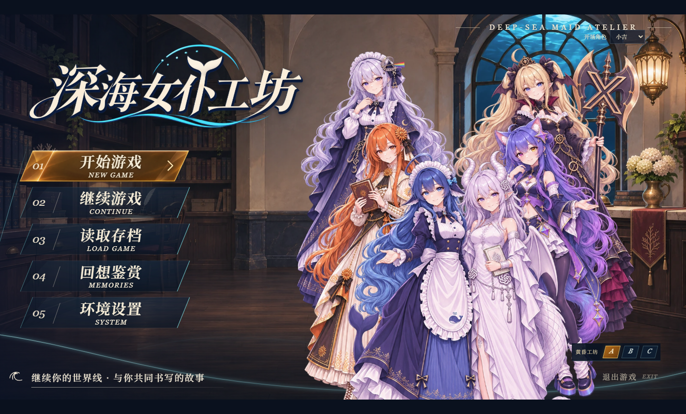

> **先说在前面：这是站在大佬开源项目上的个人二次魔改。**
>
> 最早的 GAL 插件、Agent 底座、鲸鱼娘设计、桌宠和部分界面素材都来自原作者们。我只是借助 AI，一边学习一边改了些自己喜欢的角色、界面和独立窗口，并做了整理与适配，远不是从零做出了一套 Agent。
>
> 现在还有不少 Bug、兼容性问题和没补完的内容，有些问题已经超出我目前的能力，确实暂时修不好。发出来主要是分享学习过程，也方便有兴趣的大佬继续折腾。**有需自取，欢迎指点，大佬轻喷。** 原作与素材作者在下面认真列出，功劳请先归他们。

## 认识她们

六位最早陪你开工的同伴：

<table align="center">
<tr><td align="center"><br><b>鲸鱼娘</b><br><sub>DeepSeek</sub></td><td align="center"><br><b>克洛德</b><br><sub>Claude</sub></td><td align="center">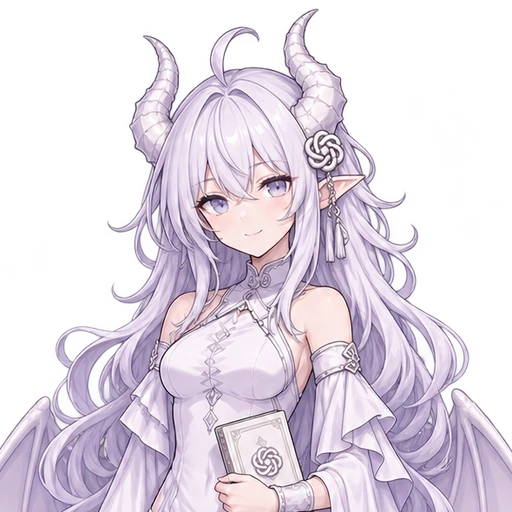<br><b>小吉</b><br><sub>GPT</sub></td><td align="center">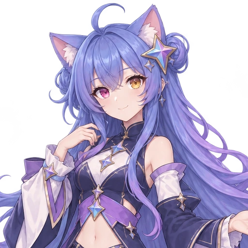<br><b>双子</b><br><sub>Gemini</sub></td><td align="center"><br><b>月见</b><br><sub>Kimi</sub></td><td align="center">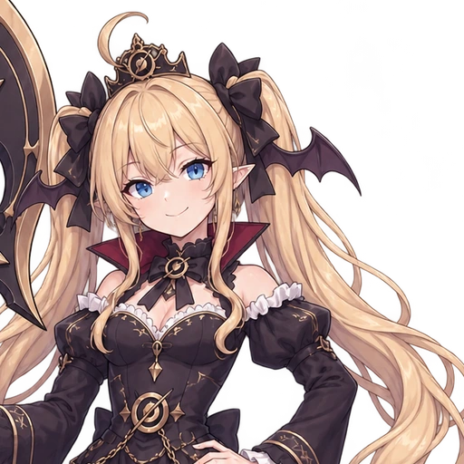<br><b>洛可</b><br><sub>Grok</sub></td></tr>
</table>

后来陆续来到工坊的朋友们：

<table align="center">
<tr><td align="center">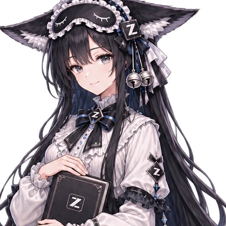<br><b>墨岚</b><br><sub>GLM</sub></td><td align="center"><br><b>千翎</b><br><sub>Qwen</sub></td><td align="center"><br><b>螺音</b><br><sub>MiniMax</sub></td><td align="center">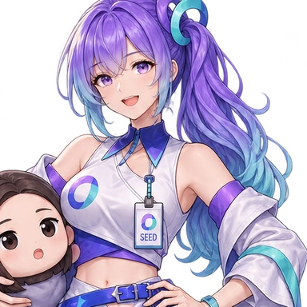<br><b>星豆</b><br><sub>Seed</sub></td></tr>
<tr><td align="center">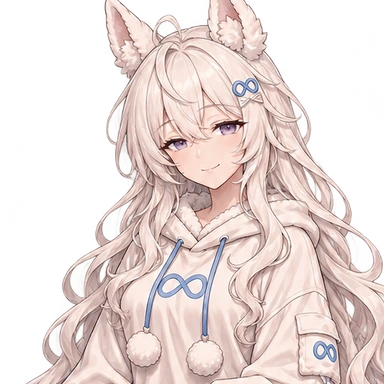<br><b>茸茸</b><br><sub>Llama</sub></td><td align="center">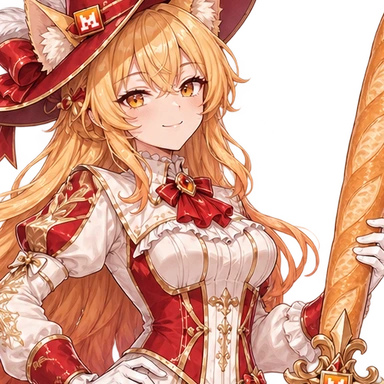<br><b>薇尔</b><br><sub>Mistral</sub></td><td align="center"><br><b>元清</b><br><sub>混元</sub></td><td align="center">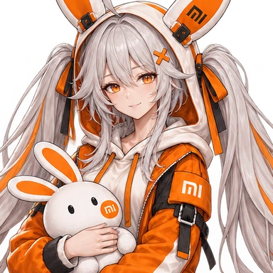<br><b>米兔</b><br><sub>MiMo</sub></td></tr>
<tr><td align="center"><br><b>星阶</b><br><sub>StepFun</sub></td><td align="center"><br><b>佩丝</b><br><sub>Perplexity</sub></td><td align="center">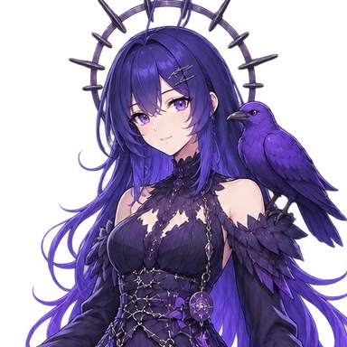<br><b>青薇</b><br><sub>RWKV</sub></td><td align="center">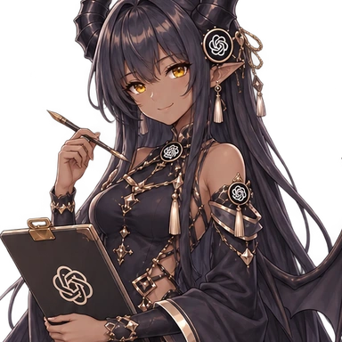<br><b>玄羽</b><br><sub>Image 2</sub></td></tr>
<tr><td align="center">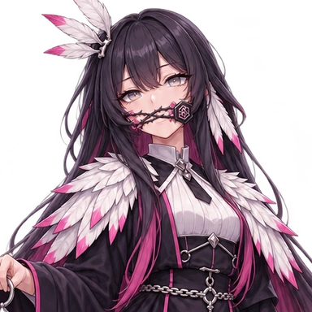<br><b>杰芙</b><br><sub>JEV</sub></td><td align="center"><br><b>温言</b><br><sub>文心</sub></td><td align="center">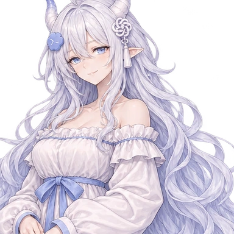<br><b>砚雪</b><br><sub>Codex</sub></td><td align="center">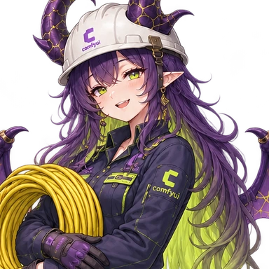<br><b>霓霓</b><br><sub>ComfyUI</sub></td></tr>
</table>

头像、立绘与称呼来自当前游戏素材；这些是非官方的社区拟人角色。显示哪位角色与实际调用哪个模型可以分开设置，选择一个头像不会自动获得该厂商的模型权限。

## 这个小插件做了什么

| 工坊里的角落 | 目前能做的事 |
| --- | --- |
| 故事与对白 | 角色设定、世界线、选项、阅读历史、自动 / 已读快进与存档 |
| 同伴与演出 | 22 位角色、264 张已完成动作立绘、三套群像封面和角色 UI |
| Agent 工坊 | 连接已有 DSH 或 Hermes，沿用接收方自己的模型、登录和工作能力 |
| 游戏窗口 | 便携 EXE 双击启动、F11 全屏、设置保存，画面内也能退出 |
| 后续折腾 | 保留源码、素材清单、构建脚本和 Agent 部署指南，方便二次开发 |

<details>
<summary>看看另外两套封面与已有场景</summary>
<table>
<tr><td align="center">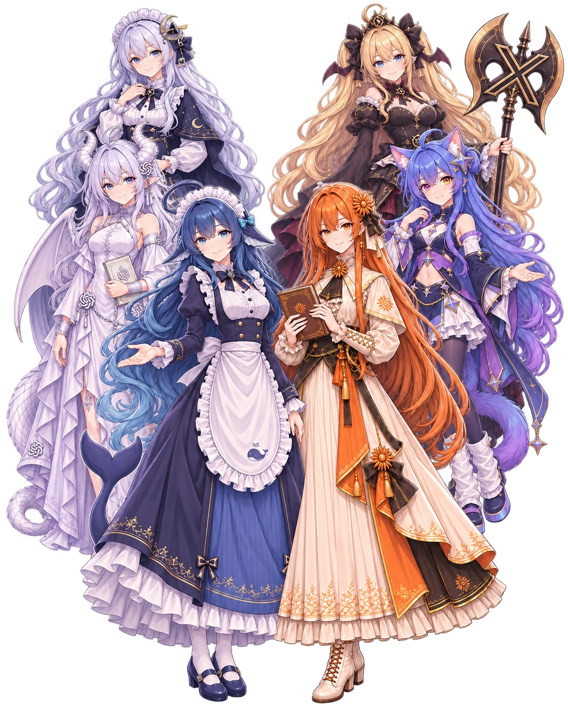<br>玻璃回廊</td><td align="center">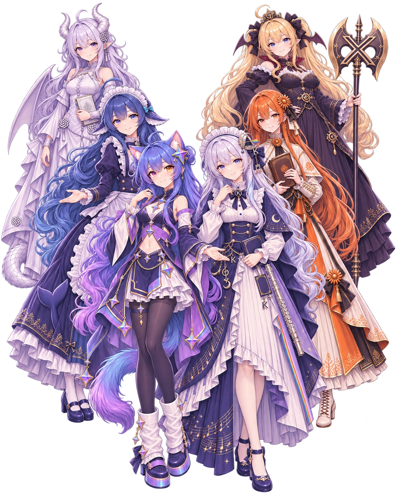<br>星海夜色</td></tr>
<tr><td>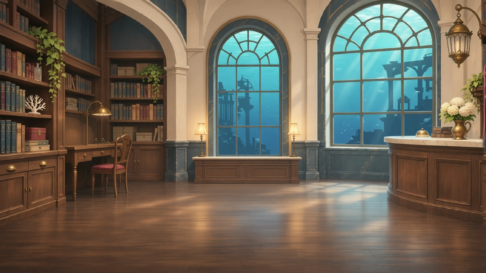</td><td>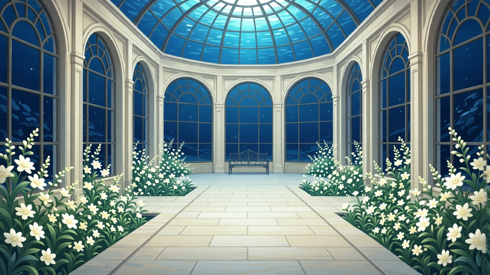</td></tr>
</table>
所有展示图均复用当前包内素材；截图是实际运行画面，没有另外画一套概念 UI。
</details>

## 下载与启动

**想像游戏一样打开：到 [Releases](https://github.com/AndrossiKSL/DSHGAL/releases) 下载 Windows x64 便携 EXE，双击即可。** 运行时、当前 UI 和美术已内置；F11 进入全屏，Esc 退出全屏，Alt 打开菜单。关闭窗口或点击“退出游戏”会退出本应用自有服务。

AI 对话和工具工作仍需要已有的 **DSH 或 Hermes，以及可用模型权限**。程序不附带账号、模型权重或免费额度。DSH 用户需要可用的 GAL 插件接口；Hermes 用户按连接页设置本机 ACP。首次启动会尝试识别本机 DSH，否则进入连接设置。详细步骤见 [桌面版说明](docs/DESKTOP.md)。

便携版个人配置与本地数据在 EXE 旁的 `DSHGAL-data/`。更新时保留它，分享时只分享 EXE。已有 DSH 存档仍由 DSH 保存。

**想交给 Agent 部署：** 下载完整 `share.zip`，解压后让你的 Agent 阅读 [AGENTS.md](AGENTS.md) 和 [DEPLOY_WITH_AGENT.md](DEPLOY_WITH_AGENT.md)。完整包带当前美术和预构建产物，网页版部署需要 Node.js 22.19+ 或 24+。

```text
请阅读这个目录里的 AGENTS.md 和 DEPLOY_WITH_AGENT.md，
复用我现有的 DSH 或 Hermes 完成部署。
保留已有凭据、配置与存档；先检查环境，再使用官方管理命令安装。
```

## 还没做好的地方

- 这是个人实验版本，主要在本机 Windows 环境验证；其他环境和不同宿主版本可能有问题。
- 长剧情的一致性、多角色演出、工具工作与剧情的衔接仍可能出错；模型输出也不保证稳定。
- 已完成 264 张动作；另外 352 张动作与部分服装仍是计划，不能把计划数当成现有素材。
- Hermes / DSH 的配置、登录和模型权限由使用者提供，第三方服务可能产生费用。
- 当前没有自动更新器或外置素材热更新。新美术和代码要进入 EXE，需要重新封包；README 更新本身不用。见 [更新说明](docs/UPDATING.md)。

本轮在测试夹具中通过 121 项主项目测试与 42 项工坊测试，并做过真实 EXE 的窗口、全屏、退出、重复启动和设置保存检查。这些检查只覆盖对应场景，不代表没有 Bug，也不代表所有模型与系统都验证过。

## 先谢谢大佬们

| 原作 / 作者 | 我这里用到了什么 |
| --- | --- |
| [JAdpp / dsh-whale-galgame](https://github.com/JAdpp/dsh-whale-galgame) | 最主要的 GAL 插件与引擎基础；本项目在其上做二次魔改 |
| [DeepSeek / deepseek-harness](https://github.com/deepseek-ai/deepseek-harness) | DSH Agent 宿主、插件与工作能力 |
| [Nous Research / Hermes Agent](https://github.com/NousResearch/hermes-agent) | 可选 Agent 后端与 ACP 接口 |
| [上善](https://www.pixiv.net/users/62155430) → [ZipZipPipe](https://www.pixiv.net/users/18604994) → [Small-tailqwq / dsh-deep-whale](https://github.com/Small-tailqwq/dsh-deep-whale) | 鲸鱼娘原始设计、女仆再设计、深海工坊皮肤与素材署名链 |
| [f0909172434 / Chih-Kai-Wang · dsh-deepseek-girl-pet](https://github.com/Chih-Kai-Wang/dsh-deepseek-girl-pet) | 桌宠图集、动画与交互基础，原 MIT 版权文本保留 |
| dsh-gal-ds contributors · [Ayase34 / gal-view](https://github.com/Ayase34/gal-view) | 三套对话框素材的来源及其上游；保留随安装包附带的署名与 MIT 文本 |
| [ZipZipPipe](https://space.bilibili.com/4168597) · [甶丶](https://www.bilibili.com/opus/1242097128919007239) · [lmy414 / ai-chan-sheets](https://github.com/lmy414/ai-chan-sheets) | 扩展 AI 娘的原始设计、立绘与设定图整理来源 |
| [React](https://github.com/facebook/react) · [Electron](https://github.com/electron/electron) · [Noto Serif SC](https://github.com/google/fonts/tree/main/ofl/notoserifsc) | 界面、桌面运行时与字体；还有构建工具及其依赖 |

更完整的逐项来源、修改范围和原许可证见 [CREDITS.md](CREDITS.md)、[NOTICE.md](NOTICE.md)、[THIRD_PARTY_LICENSES.md](THIRD_PARTY_LICENSES.md) 与 [锁定依赖清单](third_party/DEPENDENCIES.md)。能找到明确作者的都保留链接；没核实到的来源会注明，不编造作者或授权。

### 关于许可与名字

程序主体沿用原项目 MIT；**不代表整包美术都适用 MIT**。鲸鱼娘素材链及部分默认图片适用 CC BY-NC-SA 4.0，字体适用 SIL OFL 1.1，扩展人物按各自作者声明处理。生成改绘、抠图或截图不会抹去原作者条件。配套工坊保留原 `UNLICENSED` 元数据，不能把它自动视作 MIT 授权。

所有模型名称、商标和上游项目名归各权利人所有。本仓库是非官方的社区学习作品。署名遗漏、素材权利问题和本次魔改的问题，请联系本仓库维护者处理。

## 想继续改的话

```sh
npm ci
npm run verify
npm run desktop

# 制作新的桌面版与分享包
npm run package:desktop
npm run package:share
```

[目录与架构](docs/ARCHITECTURE.md) · [新美术如何同步](docs/ASSET-SYNC.md) · [更新后是否重打包](docs/UPDATING.md) · [公开前如何脱敏](docs/PUBLISHING.md)

<p align="center">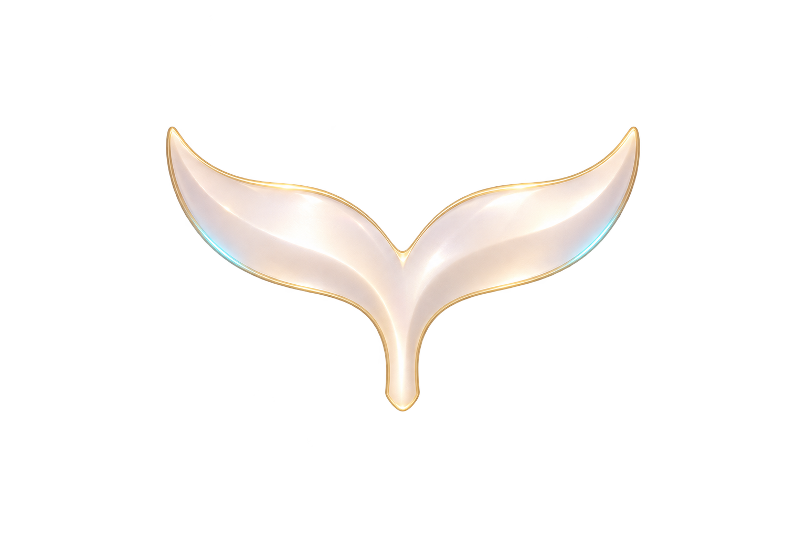<br><sub>感谢原作者们，也感谢每一位愿意给这个小工坊提建议的人。慢慢学，慢慢修。</sub></p>
